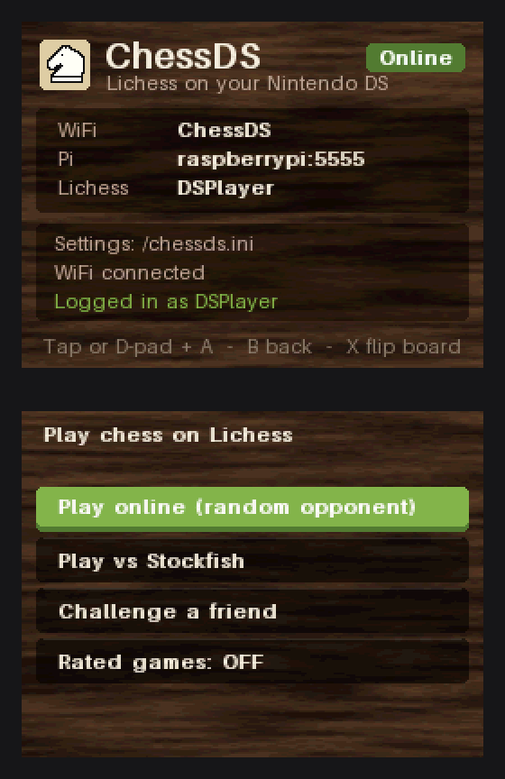
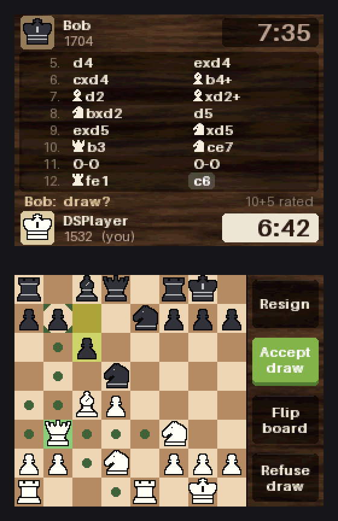
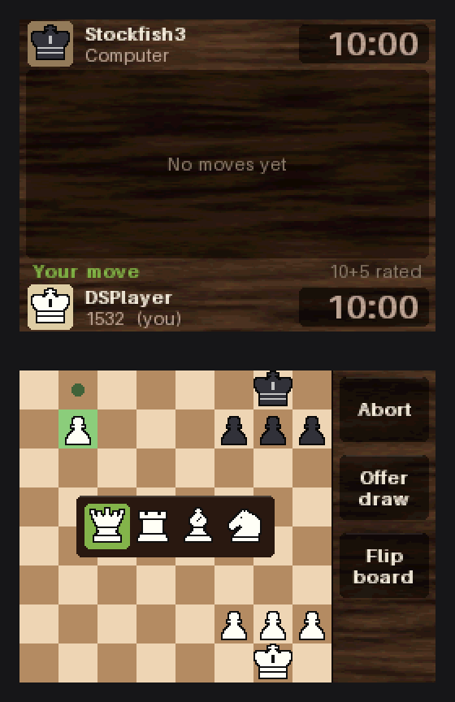

# ChessDS

Play chess on [Lichess](https://lichess.org) from a Nintendo DS.

The DS can't do HTTPS, so it talks plain TCP to a small Python bridge running
on a Raspberry Pi, and the bridge talks to the Lichess Board API:

```
DS (chessds.nds) --WiFi/TCP--> Raspberry Pi (pi/) --HTTPS--> Lichess
```

The bottom screen is the board, the top screen has the players, clocks and the
move list. The bridge keeps the Lichess token and checks moves with
[python-chess](https://python-chess.readthedocs.io), so the DS side stays simple.

<p>
  
  
  
</p>

More screens in [docs/screenshots](docs/screenshots).

## Features

- Play a random opponent (rapid or classical, casual or rated)
- Play Stockfish, levels 1-8
- Challenge friends from a list set on the Pi, and accept or decline incoming challenges
- Draw offers, resign, abort, claim the win when the opponent leaves
- Opponent chat is shown on the top screen
- Reconnects on its own and picks the game back up

## Setup

You need a DS that runs homebrew (a flashcart, or TWiLight Menu++ on a
DSi/3DS), a Raspberry Pi (or any Linux box with Python 3.9+) and a Lichess
account.

1. Create a Lichess token with the `board:play` scope:
   <https://lichess.org/account/oauth/token/create?scopes[]=board:play&scopes[]=challenge:write&description=ChessDS>

2. Install the bridge on the Pi (details in [docs/PI_SETUP.md](docs/PI_SETUP.md)):
   ```sh
   cd chessDS/pi
   sh install.sh           # virtualenv, bridge.env, systemd user service
   sh tools/set_token.sh   # asks for the token and starts the bridge
   ```

3. Pick a network for the DS. The DS only does 2.4 GHz, and a DS/DS Lite only
   supports open or WEP networks. A DSi/3DS running ChessDS in DSi mode can use
   WPA2. If your router doesn't fit, the Pi can run its own network for the DS
   (see the setup doc).

4. Build the ROM with `./build.ps1` (or `./build.sh`). This uses the BlocksDS
   Docker image and outputs `ds/chessds.nds`.

5. Copy `ds/chessds.nds` to the SD card, and `ds/chessds.ini.example` to the
   root of the card as `chessds.ini`. Fill in `ssid`, `password`, `host` (the
   Pi's IP) and `secret` (same as `CHESSDS_SECRET` on the Pi).

## Controls

| | Touch | Buttons |
| --- | --- | --- |
| Move | Tap a piece, then a square | D-pad + A |
| Cancel / back | Tap elsewhere | B |
| Promotion | Tap a piece in the popup | Left/Right + A |
| Flip board | Flip button | X |
| Resign / abort | Tap twice | |

Hold L while ChessDS starts to force DS-mode WiFi on a DSi.

## Limitations

- The Board API only allows rapid or slower games against random opponents.
  Blitz works against Stockfish and friends, bullet doesn't work at all.
- Standard chess only, no Chess960 or other variants.
- No premoves, takebacks or sending chat from the DS.
- Correspondence games only show up if you start or accept them from the DS.

The bridge only uses python-chess for legality and SAN, never for move
suggestions, since engine help is against Lichess rules.

## Development

```
ds/             DS client (C, BlocksDS)
  source/       main.c (main loop, connection), game.c, lobby.c, net.c, gfx.c, ...
  tools/        fonts.py, art.py, preview/ (renders the screens on a PC)
pi/             bridge (Python)
  tests/        unit tests and end-to-end tests against a fake Lichess
  tools/        fake_ds.py, set_token.sh, setup_hotspot.sh
docs/           Pi setup, protocol
```

- Tests: `cd pi && python -m unittest discover -s tests -t .`
- Talk to the bridge without a DS: `python pi/tools/fake_ds.py --host <pi> --secret <secret>`,
  then type commands like `AI 1 10 0 random` or `MOVE e2e4`.
- Screenshots: `python ds/tools/preview/screens.py` compiles the DS code for
  the PC, runs a scripted session and writes `docs/screenshots/` (needs Pillow,
  python-chess and gcc or Docker).
- Piece art is ASCII in `ds/source/pieces.c`; preview it with
  `python ds/tools/art.py preview out.png`.
- Fonts: `python ds/tools/fonts.py` regenerates `font_data.c`. The text font is
  [Aileron](https://dotcolon.net/font/aileron/) (public domain), which comes
  with Pillow.
- Protocol: [docs/PROTOCOL.md](docs/PROTOCOL.md).
